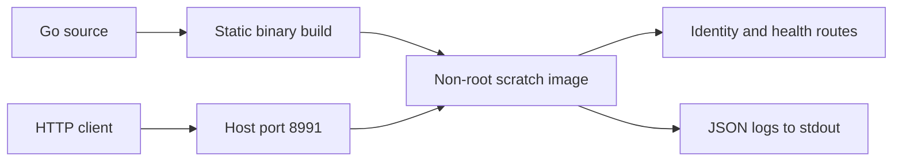

# Portlight — HTTP Server

**Run a containerized Go service with health probes, request logs, and graceful shutdown.**

A focused Go HTTP service with a predictable startup, a small JSON API, and a
clean shutdown. Built from Docker coursework into a containerized service with
validated configuration, structured logs, and a minimal runtime image.

[Install the service](#-installation) · [View the HTTP contract](#-api-reference) · [Read operating boundaries](#-security-and-limitations)

##  Features

- **Explicit behavior:** GET and HEAD routes, real 404s, and method rejection.
- **Clear signals:** health endpoints and JSON request logs.
- **Bounded connections:** header, read, write, and idle timeouts.
- **Clean exits:** SIGINT and SIGTERM drain active requests for up to ten seconds.
- **Small runtime:** a static Go binary in a scratch image, running as UID 65532.
- **No third-party Go dependencies:** the service uses the standard library.

##  Installation

With **Git, Docker Engine, Docker Compose v2, Bash, and curl** installed, one line
clones the project, builds the image, starts the service, and waits for readiness:

```bash
git clone https://github.com/yaqyn/portlight-http-server.git && cd portlight-http-server && ./launch
```

The launcher prints **Ready: http://localhost:8991** after the health check succeeds.
It checks prerequisites and explains daemon, permission, and port-conflict errors.
It does not install system packages or require a local Go toolchain.

Already cloned? Run **`./launch`** from the repository.

| Task | Command |
| --- | --- |
| Start or rebuild | `./launch` |
| Stop and remove project containers | `./launch stop` |
| Inspect container status | `./launch status` |
| Check readiness without restarting | `./launch check` |
| Follow logs | `./launch logs` |
| Show usage | `./launch help` |
| Choose another port | `HOST_PORT=8992 ./launch` |

Startup waits for `/readyz`. Use `./launch check` to check readiness with a
two-second request timeout without building or starting containers; an unavailable
service returns a nonzero status. Set `HOST_PORT` for checks on a custom port.

Starting is explicit: the service does not auto-start on reboot. Logs can be closed
with Ctrl+C without stopping the service. The Compose project name is fixed to
`portlight`, so commands target the same project regardless of folder name.

<details>
<summary>Prefer running directly with Go?</summary>

Requires Go 1.27.1+:

```bash
go run .
curl http://localhost:8991/
```

Run `go run . -version` to print the build version without starting the server. Override the listening port with `PORT=8080 go run .`. Missing `PORT` defaults to
8991; invalid values exit with an error. Ctrl+C gracefully stops the native server.

</details>

To build a versioned image yourself:

```bash
docker build --build-arg VERSION=1.0.0 -t yaqyn/portlight-http-server:1.0.0 .
```

###  Run the published image

```bash
docker run -d --name portlight --read-only --cap-drop ALL --security-opt no-new-privileges -p 127.0.0.1:8991:8991 yaqyn/portlight-http-server:1.0.0
```

[Docker Hub](https://hub.docker.com/r/yaqyn/portlight-http-server) hosts the image.
Use `1.0.0` for this release or `latest` for the current published release. Images
currently target Linux amd64. Remove the container with `docker stop portlight`
followed by `docker rm portlight` when finished.

##  API reference

| Route | GET response | Purpose |
| --- | --- | --- |
| `/` | Service name, description, and build version | Identify the deployment |
| `/version` | Service name and build version | Check deployed build metadata |
| `/status` | Service name, health status, and build version | Inspect identity and health together |
| `/healthz` | `{"status":"ok"}` | Confirm HTTP handling is alive |
| `/livez` | `{"status":"ok"}` | Kubernetes-style liveness probe alias |
| `/readyz` | `{"status":"ok"}` | Confirm this dependency-free service is ready |

HEAD is supported on these routes. Other methods return 405; unknown routes
return 404. Responses disable caching and send `X-Content-Type-Options: nosniff`.
Every response also sends `X-Service-Version` so clients can identify the deployed build without a second request.
The API has no query options; query parameters on known routes return 400 instead of being silently ignored.
Health endpoints contain no dependency checks because the service has no database
or external service dependencies.

##  Architecture



The image builds from source rather than a binary sitting on a developer's
machine. Its build context includes only the Go module and application source;
local credentials, examples, and generated assets stay outside the image.

##  Verification

```bash
go test -race -cover ./...
go vet ./...
docker compose config --quiet
python3 -m unittest discover -s tests -v
```

Launcher tests require only Python 3 and Bash; mocked Docker and curl commands
cover readiness, failure handling, custom ports, and startup probe selection.
CI verifies formatting, tests, static analysis, image construction, HTTP smoke
checks, and a zero-exit graceful container shutdown. No deployment or registry
credentials are required by the workflow.

##  Security and limitations

| Setting | Value |
| --- | --- |
| Header / read / write / idle timeouts | 5s / 15s / 15s / 60s |
| Maximum request headers | 16 KiB |
| Shutdown drain deadline | 10s |
| Compose stop grace period | 15s |
| Compose resources | 128 MiB memory, 1 CPU, 64 processes |
| Runtime privileges | Non-root, read-only filesystem, no capabilities |
| Local logs | Rotated local driver, 10 MiB × 3 files |
| Automatic restart | Disabled for on-demand development |

Every request receives a fresh `X-Request-ID` response header, also recorded as `request_id` in its log; client-supplied IDs are not reused. Every request logs method, path, status, `bytes_written` accepted by the response writer, and elapsed milliseconds. This byte count is application output, not network traffic accounting (HEAD bodies may be suppressed by HTTP). Request bodies,
query parameters, and authorization headers are not logged. Avoid personal data
in URL paths, which are logged.

For public deployments, place the service behind a TLS reverse proxy and set
appropriate ingress limits, monitoring, and restart policy in your deployment
platform. There is no authentication, database, rate limiter, or persistence.
This repository provides a hardened small-service baseline, not evidence of
production deployment or a security certification. Rebuild regularly to pick up
Go security updates and verify the image in your own environment.

##  Learning context

Portlight started as a Boot.dev Docker exercise. The original Caddy networking
configuration and Python book-report exercise remain under `examples/`; they
are separate teaching artifacts and are excluded from the production image.

---

Developed by **[Abdulrahman M. Yaqyn](https://yaqyn.github.io/folio-static-site/)**.

> **Learning Journey Project · Boot.dev**
> Developed through Docker coursework and extended with practical server hardening.
